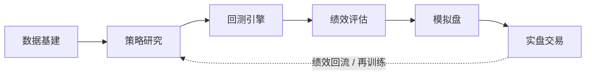

# 个人 A 股量化交易闭环（a-share-quant-workflow）

> 一句话结论：在大 A 自己搞量化，**最佳路径不是一上来写深度学习预测涨跌**，而是
> **先在回测平台把流程跑通 → 用现成工程能力把数据与实盘工程化 → 严控回测陷阱 →
> 小资金实盘 + DevOps 式监控闭环**。心法：**先求"跑通且别亏大钱"，再求 alpha。**

本仓库是这个闭环的可运行实现，按功能分四个 PR 逐步落地：

| PR | 模块 | 内容 |
|---|---|---|
| `feature/data-infra` | `data/` | AkShare 拉数 + DuckDB 落库 + CLI |
| `feature/first-backtest` | `backtest/` | 通用事件/规则回测引擎 + 降息事件示例 + 低波选股示例 |
| `feature/platform-compare` | `docs/` | 聚宽/米筐/优矿/qlib/backtrader/vectorbt 对比与选型 |
| `feature/live-skeleton` | `live/` | 迅投 QMT 下单骨架 + Prometheus/Grafana 监控 |

---

## 量化闭环流程



- **数据基建**：行情/财务/因子/另类数据落地（Parquet/DuckDB）。
- **策略研究**：从可解释假设出发（低波、价值、反转、事件…），Jupyter + pandas 验证。
- **回测引擎**：处理前视/幸存者/成本/涨跌停封板，得出可信收益。
- **绩效评估**：年化、夏普、卡玛（收益/最大回撤）、胜率、盈亏比、样本外、参数稳定性。
- **模拟盘**：1–3 个月无风险验证全链路。
- **实盘交易**：小资金、分仓、严格止损；绩效回流再训练，形成闭环。

---

## A 股特有约束（决定技术选型与策略有效性）

| 约束 | 对量化的影响 | 必须做的处理 |
|---|---|---|
| T+1 交易 | 当天买当天卖不掉 | 无真正日内策略，须隔夜；信号提前一日算 |
| 涨跌停板 ±10%（双创 ±20%，ST ±5%） | 涨停买不进、跌停卖不出 | 回测模拟"封板无法成交"，否则收益虚高 |
| 做空/融券受限 | 中性、对冲难做 | 个人多走 long-only 或多空比受限 |
| 印花税 0.05% 单边 + 佣金万 2–3 + 过户费 | 高频成本吞噬利润 | 换手率进回测；低频/选股更友好 |
| 政策市 + 散户占比高（~60%+） | 反转因子强于动量（与美股相反） | 因子本地验证，别直接搬海外因子 |
| 退市加速 + 财务造假 + 停牌 | 幸存者偏差严重 | 回测含已退市标的 |

---

## 技术栈分层（复用 DevOps / Python / C++ / AI 背景）

| 层 | 推荐 | 说明 |
|---|---|---|
| 数据 | AkShare / Tushare → Parquet / DuckDB | 建本地干净数仓 |
| 研究 | Python(pandas/polars) + lightgbm/xgboost | ML 因子合成顺手 |
| 回测 | 起步聚宽/米筐，进阶 qlib / backtrader | 平台打底保正确，本地要可控 |
| 调度/工程 | K8s + 定时任务 | 复用现有运维能力 |
| 监控（王牌） | Prometheus + Grafana | 信号延迟/断流/成交异常/回撤告警 |
| 实盘 | 迅投 QMT（Python API） | 程序化下单门槛低 |
| 部署 | 云服务器 7×24 / AutoDL | ¥200–500/月预算 |

---

## 分阶段路线图

| 阶段 | 目标 | 时间 | 产出 |
|---|---|---|---|
| 0 定位 | 定资金/风险/时间/策略类型 | 1 周 | 投资计划书 |
| 1 数据 | 数据落地 + 清洗 | 1–2 周 | 本地数仓 + 更新脚本 |
| 2 首策略 | 平台跑出可信回测 | 2–4 周 | 回测报告 |
| 3 严评 | 样本外 + walk-forward + 稳定性 | 2 周 | 通过/不通过判定 |
| 4 模拟盘 | 全链路无风险验证 | 1–3 月 | 模拟净值 |
| 5 小实盘 | 小资金 + 分仓 + 止损 | 3–6 月 | 实盘收益/回撤/监控 |
| 6 迭代 | 因子库/ML/多策略组合 | 持续 | 组合层收益 |

---

## 9 个致命坑（回测阶段尤其）

1. **过拟合**：参数调到完美但样本外崩 → walk-forward、参数稳定性。
2. **前视偏差**：用了当时还不知道的数据（公告当日收盘价）→ 信号 T 日收盘算、T+1 开盘成交。
3. **幸存者偏差**：只回测现存标的 → 含已退市标的。
4. **涨跌停虚成交**：回测里涨停照买 → 必须封板模拟。
5. **成本低估**：忽略印花税/佣金/滑点 → 换手率进模型。
6. **流动性陷阱**：小票吃不到 → 限流动性/市值门槛。
7. **单次大事件主导均值**（如 "924" 把均值从 0.15% 拉到 1.77%）→ 看中位数、剔除极端、看分布。
8. **策略容量**：小资金策略大资金失效 → 评估冲击成本。
9. **只看收益不看回撤**：一年翻倍但中途 −50% 扛不住 → 卡玛比率优先。

---

## 目录结构（随 PR 演进）

```
a-share-quant-workflow/
├── README.md                 # 本文件（流程总纲）
├── requirements.txt          # 根依赖
├── data/                     # [PR1] 数据基建
├── backtest/                 # [PR2] 回测引擎与示例
├── docs/                     # [PR3] 平台对比
└── live/                     # [PR4] 实盘骨架
```

---

> ⚠️ 以上内容由 AI 基于公开信息整理生成，仅供参考，不构成任何投资建议或个股推荐。投资有风险，决策需谨慎。
